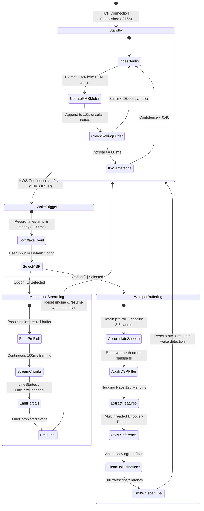
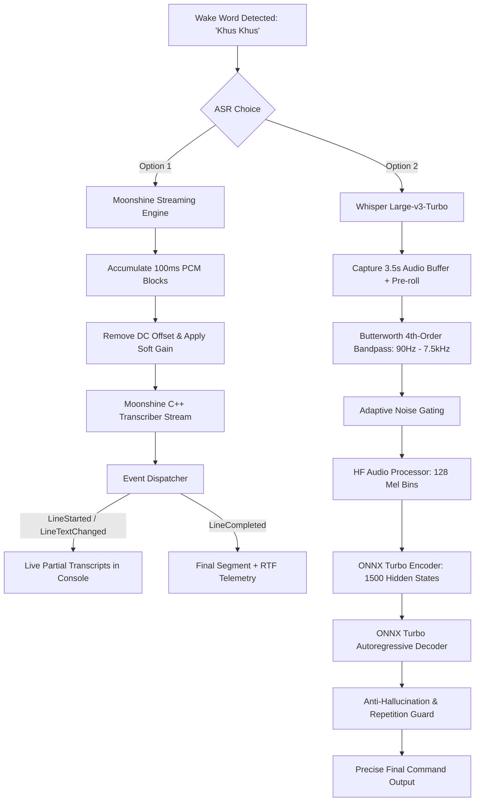

# ESP32-S3 AI Voice Assistant: Dual ASR, TinyML KWS & Groq AI Assistant

[](https://www.python.org/)
[](https://www.espressif.com/en/products/socs/esp32-s3)
[](https://pytorch.org/)
[-blueviolet.svg)](https://groq.com/)
[](https://github.com/usefulsensors/moonshine)
[](https://huggingface.co/openai/whisper-large-v3-turbo)
[](#performance-benchmarks--specifications)

An end-to-end, edge-to-server speech recognition and conversational AI system combining **ESP32-S3 Wi-Fi audio streaming**, an ultra-low-latency custom **1D Depthwise-Separable CNN Keyword Spotting (KWS)** model (*"Khus Khus"*), and a **Triple-Engine Operating Pipeline**:
1. **Moonshine Streaming Voice**: Real-time edge streaming continuous transcription.
2. **Voice AI Assistant (Groq Cloud API)**: Conversational voice assistant providing spoken real-time answers (Live Weather via Open-Meteo, Time/Date, and General Knowledge powered by Llama 3.1 8B).
3. **Whisper Large-v3-Turbo**: High-accuracy hardware-accelerated ONNX speech recognition with 4th-order Butterworth DSP noise filtration.

---

## 📑 Table of Contents

- [System Architecture](#-system-architecture)
- [End-to-End Workflow & State Machine](#-end-to-end-workflow--state-machine)
- [Audio & Inference Pipeline Deep Dive](#-audio--inference-pipeline-deep-dive)
  - [1. Edge Audio Acquisition (ESP32-S3 + INMP441)](#1-edge-audio-acquisition-esp32-s3--inmp441)
  - [2. Network Streaming Protocol](#2-network-streaming-protocol)
  - [3. Host Ingestion & Standby KWS Engine](#3-host-ingestion--standby-kws-engine)
  - [4. Dual ASR Engines (Moonshine vs. Whisper Turbo)](#4-dual-asr-engines-moonshine-vs-whisper-turbo)
- [Hardware Wiring & Pinout](#-hardware-wiring--pinout)
- [Repository Structure](#-repository-structure)
- [Installation & Quickstart](#-installation--quickstart)
  - [1. Host Setup](#1-host-setup)
  - [2. ESP32-S3 Firmware Configuration & Flashing](#2-esp32-s3-firmware-configuration--flashing)
  - [3. Running the Server](#3-running-the-server)
  - [4. Operational Execution](#4-operational-execution)
- [Performance Benchmarks & Specifications](#-performance-benchmarks--specifications)
- [Logging & Telemetry](#-logging--telemetry)
- [Troubleshooting & Calibration](#-troubleshooting--calibration)

---

## 🌟 System Architecture

The system splits compute workloads intelligently between the microcontroller edge (audio capture, I2S DMA, bit-depth downscaling, dynamic gain) and the host workstation (feature extraction, rolling KWS wake-word detection, and compute-heavy ASR transcription).

```
 ┌────────────────────────────────────────────────────────────────────────┐
 │                      ESP32-S3 EDGE DEVICE                             │
 │                                                                        │
 │  ┌───────────────────────┐                                             │
 │  │  INMP441 MEMS Mic     │ (24-bit audio in 32-bit slot over I2S)      │
 │  └──────────┬────────────┘                                             │
 │             │ I2S DMA Ring Buffer (8 x 512 bytes)                      │
 │             ▼                                                          │
 │  ┌───────────────────────┐                                             │
 │  │ Bitshift & DSP Gain   │ >> 14 downshift to 16-bit PCM               │
 │  │ (sample >> 14) * 2    │ [-32768, 32767] hard-clip guard            │
 │  └──────────┬────────────┘                                             │
 │             │ 16 kHz Mono 16-bit Linear PCM (1024-byte packets)        │
 └─────────────┼──────────────────────────────────────────────────────────┘
               │  TCP Socket (:8766 over Wi-Fi 802.11 b/g/n)
               ▼
 ┌────────────────────────────────────────────────────────────────────────┐
 │                      HOST SERVER (server.py)                           │
 │                                                                        │
 │  ┌──────────────────────────────────────────────────────────────────┐  │
 │  │              Asyncio Non-Blocking TCP Socket Server              │  │
 │  │        RMS Audio Visualizer Meter [##########----------]         │  │
 │  └──────────────────────────────┬───────────────────────────────────┘  │
 │                                 │                                      │
 │                                 ▼                                      │
 │  ┌──────────────────────────────────────────────────────────────────┐  │
 │  │      Rolling 1.0s Circular Audio Buffer (16,000 samples)         │  │
 │  │             Evaluation Cadence: Every 60 ms                      │  │
 │  └──────────────────────────────┬───────────────────────────────────┘  │
 │                                 │                                      │
 │                                 ▼                                      │
 │  ┌──────────────────────────────────────────────────────────────────┐  │
 │  │                  KhusKhus-KWS Wake-Word Engine                   │  │
 │  │  • 40 Log-Mel Spectrogram Extraction (25ms window, 10ms hop)     │  │
 │  │  • 1D Depthwise-Separable CNN Classifier (Stem -> 3x DS -> GAP)  │  │
 │  │  • Latency: ~0.09 ms | Accuracy: 99.77% | F1-Score: 1.00         │  │
 │  └──────────────────────────────┬───────────────────────────────────┘  │
 │                                 │                                      │
 │                                 ▼                                      │
 │                [Confidence >= 0.40: WAKE TRIGGERED]                    │
 │                                 │                                      │
 │                 Operational Mode Selection / Dispatch                │
 │        ┌─────────────────────────┼─────────────────────────┐        │
 │        ▼                         ▼                         ▼        │
 │ ┌───────────────┐       ┌─────────────────┐       ┌───────────────┐ │
 │ │ Mode 1:       │       │ Mode 2:         │       │ Mode 3:       │ │
 │ │ Moonshine     │       │ Voice AI        │       │ Whisper Large │ │
 │ │ Streaming ASR │       │ Assistant       │       │ v3-Turbo      │ │
 │ │ • Continuous  │       │ • Groq Llama3.1 │       │ • Butterworth │ │
 │ │   real-time   │       │ • Live Weather  │       │   DSP filter  │ │
 │ │ • Sub-100ms   │       │ • TTS Voice Out │       │ • ONNX Engine │ │
 │ └───────┬───────┘       └────────┬────────┘       └───────┬───────┘ │
 │         │                        │                        │         │
 │         └────────────────────────┼────────────────────────┘         │
 │                                  ▼                                  │
 │  ┌──────────────────────────────────────────────────────────────────┐  │
 │  │             Terminal Display & live_transcript_log.txt           │  │
 │  │        Timestamped transcripts, Latency (ms), RTF profiling      │  │
 │  └──────────────────────────────────────────────────────────────────┘  │
 └────────────────────────────────────────────────────────────────────────┘
```

---

## 🔄 End-to-End Workflow & State Machine

The server operates as an event-driven state machine transitioning through standby, detection, dispatch, and transcription phases:



### Execution Lifecycle Steps:
1. **Edge Audio Acquisition**: The ESP32-S3 reads 32-bit I2S data from the INMP441 microphone over DMA, applies bit-shift downscaling and a 2x digital volume boost to form 16 kHz 16-bit mono PCM, and streams the raw bytes over TCP.
2. **Buffer Ingestion & Visual Feedback**: The host TCP server receives the audio in 1024-byte chunks, updates an ASCII RMS audio activity meter, and manages a 1.0-second rolling circular buffer (32,000 bytes).
3. **Standby KWS Wake Word Inference**: Every 60 ms, the 1.0-second window is transformed into 40-band Log-Mel spectrogram features and passed through the `KhusKhus-KWS` neural network.
4. **Wake Event Trigger**: When the confidence score for `"khus khus"` reaches or exceeds **0.40** (40%), the server triggers the wake state, captures the pre-roll audio, and requests an ASR engine selection.
5. **ASR Dispatch**:
   - **Moonshine Streaming Voice**: Immediate continuous streaming with sub-100 ms chunk latency and partial hypothesis updates emitted to the terminal in real time.
   - **Whisper Large-v3-Turbo**: Captures a ~3.5s command window, passes the audio through a 4th-order Butterworth bandpass filter (90 Hz – 7500 Hz), extracts 128 Mel channels, and runs high-precision multi-threaded ONNX inference with anti-hallucination suppression.
6. **Telemetry & Logging**: Detailed metrics (feature extraction time, model inference time, decoding time, total latency, duration, and RTF) are printed to the console and appended to `live_transcript_log.txt`.

---

## 🔬 Audio & Inference Pipeline Deep Dive

### 1. Edge Audio Acquisition (ESP32-S3 + INMP441)
The INMP441 is an omnidirectional MEMS microphone with an internal 24-bit I2S analog-to-digital converter.
* **DMA Configuration**: Dual-channel 32-bit slot configured for left-channel-only reading (`I2S_CHANNEL_FMT_ONLY_LEFT`).
* **Bit Depth Conversion**: The microphone places 24-bit audio in the most significant bits of a 32-bit container. The ESP32 firmware extracts clean 16-bit PCM via a right bitshift and scales it with digital gain:
  $$\text{sample}_{16} = \text{clip}\left( (\text{rawBuffer}[i] \gg 14) \times \text{AUDIO\_GAIN}, -32768, 32767 \right)$$
* **DMA Buffer Allocation**: 8 buffers $\times$ 512 samples to eliminate packet drops under Wi-Fi contention.

### 2. Network Streaming Protocol
* **Protocol**: Low-overhead raw TCP stream over port `8766`.
* **Payload**: Uncompressed linear PCM (16,000 Hz, 16-bit, signed little-endian, single-channel).
* **Chunk Sizing**: 1024 bytes per socket packet (32 ms of audio per packet), ensuring negligible network queuing delay.

### 3. Host Ingestion & Standby KWS Engine
* **Feature Extraction (`kws/features.py`)**:
  * Audio is normalized to floating-point $[-1.0, 1.0]$ and DC-bias removed ($x - \bar{x}$).
  * STFT: 400-point FFT (25 ms analysis window), 160-point hop length (10 ms time step).
  * 40 Mel filterbanks spanning 20 Hz to 7,600 Hz.
  * Logarithmic compression: $\log(\text{Mel} + 10^{-6})$.
  * Input tensor shape: `[Batch=1, Mel=40, Time=98]`.
* **Neural Architecture (`KhusKhusKWS` in `kws/model.py`)**:
  A custom 1D Depthwise-Separable Convolutional Neural Network engineered for microsecond-scale execution:
  ```
  Input: (1, 40, 98)
    │
    ▼
  [Stem Conv1d]               Conv1d(40 -> 32, k=5, s=1) + BatchNorm1d + ReLU6
    │
    ▼
  [DS Block 1 (Downsample)]    Depthwise Conv1d(32 -> 32, k=5, s=2) + BN + ReLU6
                              Pointwise Conv1d(32 -> 48, k=1, s=1) + BN + ReLU6
    │
    ▼
  [DS Block 2 (Downsample)]    Depthwise Conv1d(48 -> 48, k=5, s=2) + BN + ReLU6
                              Pointwise Conv1d(48 -> 64, k=1, s=1) + BN + ReLU6
    │
    ▼
  [DS Block 3 (Residual)]      Depthwise Conv1d(64 -> 64, k=3, s=1) + BN + ReLU6
                              Pointwise Conv1d(64 -> 64, k=1, s=1) + BN + ReLU6
                              Residual Connection (Skip Add)
    │
    ▼
  [Global Average Pooling]    AdaptiveAvgPool1d(1) -> (1, 64)
    │
    ▼
  [Linear Classifier]         Linear(64 -> 3 classes: [Keyword, Other Speech, Noise])
    │
    ▼
  [Softmax Activation]        P(wake_word) = Softmax(logits)[0]
  ```
* **Performance**: Runs in **0.09 ms on CPU** with 99.77% validation accuracy. Pre-exported C arrays (`khuskhus_kws_model_data.h`) and INT8 TFLite models are available for microcontrollers.

### 4. Dual ASR Engines (Moonshine vs. Whisper Turbo)



#### Engine 1: Moonshine Voice Streaming Engine (`moonshine_streaming_engine.py`)
* **Technology**: Official Pretrained Moonshine Voice C++ runtime wrapper (`moonshine_voice`).
* **Framing & Ingestion**: Audio chunks are buffered into 1600-sample (100 ms) windows.
* **Acoustic Preconditioning**:
  - DC bias removal: $s = s - \text{mean}(s)$.
  - Soft Dynamic Range Compression: Soft boost for quiet voice signals ($\text{RMS} \in [0.001, 0.03]$) capped at $3.0\times$ without clipping.
* **Callback System**: Subscribes to `LineStarted`, `LineTextChanged`, and `LineCompleted` events, displaying live partial hypothesis strings with sub-100 ms model latencies.

#### Engine 2: Whisper Large-v3-Turbo Engine (`whisper_asr/`)
* **Technology**: OpenAI's 800M-parameter distilled sequence-to-sequence model running on a multi-threaded ONNX Runtime session.
* **Pre-roll Retention**: Keeps the 1.0-second pre-wake audio buffer to ensure the first spoken syllables are never clipped.
* **Butterworth DSP Bandpass Filter**:
  A 4th-order zero-phase IIR Butterworth filter (`scipy.signal.filtfilt`):
  $$H(s) = \frac{1}{1 + \sum_{k=1}^{4} a_k s^k}, \quad f_{\text{low}} = 90\text{ Hz}, \quad f_{\text{high}} = 7500\text{ Hz}$$
  Eliminates electrical hum, 50/60 Hz mains rumble, and high-frequency thermal hiss.
* **Hallucination & Loop Safeguards**:
  - `no_repeat_ngram_size = 3`: Blocks repetitive looping phrases.
  - `repetition_penalty = 1.25`: Penalizes redundant token generation.
  - Pattern blocklist: Rejects phantom phrases (e.g., *"Thank you for watching"*, *"Subtitles by"*, *"men men men"*).
* **Multi-stage Latency Profiling**: Measures feature extraction time, ONNX inference time, and token decode time independently.

---

## 🔌 Hardware Wiring & Pinout

Connect the **INMP441 MEMS microphone** module to the **ESP32-S3** board as follows:

| INMP441 Pin | ESP32-S3 Pin | Function | Notes & Recommendations |
| :--- | :--- | :--- | :--- |
| **VDD** | `3.3V` | System Power | Must use a clean, regulated 3.3V rail |
| **GND** | `GND` | Ground | Connect to common ground plane |
| **SD** | `GPIO 4` | Serial Data (I2S DOUT) | Audio PCM data input |
| **WS** | `GPIO 5` | Word Select (I2S LRCLK) | Channel selection clock |
| **SCK** | `GPIO 6` | Serial Clock (I2S BCLK) | Continuous bit clock |
| **L/R** | `GND` | Channel Select | Tied to GND to output on Left channel |

> [!IMPORTANT]
> Keep the jumper wires between the INMP441 and ESP32-S3 as short as possible (< 15 cm) to minimize clock capacitance and prevent high-frequency I2S bit jitter.

---

## 📁 Repository Structure

```text
.
├── esp32_firmware/
│   └── esp32_firmware.ino            # ESP32-S3 I2S DMA audio capture & TCP streaming client
│
├── kws/                              # Keyword Spotting package ("Khus Khus")
│   ├── __init__.py                   # Package initializer
│   ├── config.py                     # Audio signal, spectrogram & model hyperparameter configs
│   ├── features.py                   # PyTorch LogMelFeatureExtractor (40-mels, 16 kHz)
│   └── model.py                      # KhusKhusKWS 1D Depthwise-Separable CNN architecture
│
├── models/
│   ├── kws/
│   │   ├── best_model.pth            # Trained PyTorch KhusKhus-KWS weights (99.77% acc)
│   │   ├── final_model.pth           # Final training checkpoint
│   │   ├── kws_model_int8.tflite     # Quantized INT8 model for microcontroller deployment
│   │   ├── kws_model.onnx            # Exported ONNX graph for KWS
│   │   └── khuskhus_kws_model_data.h # C header array for ESP32 TFLite-Micro execution
│   └── whisper/                      # Symlink / pointer to Whisper ONNX artifacts
│
├── whisper_asr/                      # Whisper Large-v3-Turbo Edge Runtime
│   ├── config.py                     # Audio device, VAD, DSP filter & decoding parameters
│   ├── live_streaming.py             # Butterworth 4th-order DSP filter & hallucination guards
│   ├── model.py                      # Unified model loader (ONNX / TFLite / PyTorch)
│   ├── tflite_engine.py              # Multi-threaded ONNX / LiteRT autoregressive engine
│   ├── whisper_engine.py             # WhisperTurboASREngine audio processing wrapper
│   └── models/tflite/                # ONNX encoder & decoder weights
│       ├── whisper_turbo_encoder.onnx & .onnx.data
│       └── whisper_turbo_decoder.onnx & .onnx.data
│
├── voice_assistant/                  # Voice AI Assistant (Groq Cloud API & Tools)
│   ├── __init__.py                   # Package exports
│   ├── assistant_engine.py           # Core assistant coordinator (STT -> Groq -> TTS)
│   ├── groq_client.py                # Ultra-fast Groq Cloud API with function calling
│   ├── weather_tool.py               # Free live Open-Meteo weather resolver
│   └── tts.py                        # Asynchronous non-blocking Speech Synthesizer
│
├── test_voice_assistant.py           # Standalone laptop mic test suite for Voice Assistant
├── test_client.py                    # Laptop mic audio streaming client (stands in for ESP32)
├── moonshine_streaming_engine.py     # Moonshine Voice streaming ASR integration & callbacks
├── server.py                         # Central TCP socket server (port 8766) & dispatcher
├── requirements.txt                  # Python dependencies
├── live_transcript_log.txt           # Structured execution and transcription audit log
└── README.md                         # Comprehensive documentation
```

---

## ⚡ Installation & Quickstart

### 1. Host Setup

1. **Clone repository**:
   ```bash
   git clone https://github.com/adisingh592/Asr-Model.git
   cd Asr-Model
   ```

2. **Create and activate a virtual environment**:
   ```bash
   python -m venv .venv
   # Windows:
   .venv\Scripts\activate
   # Linux/macOS:
   source .venv/bin/activate
   ```

3. **Install dependencies**:
   ```bash
   pip install -r requirements.txt
   ```

4. **Configure Environment Variables (`.env`)**:
   - Create your local `.env` by copying the template:
     ```bash
     cp .env.example .env
     ```
   - Get a free API key at [console.groq.com/keys](https://console.groq.com/keys) (instant sign-up with Google/GitHub, no credit card required).
   - Open `.env` and paste your key:
     ```env
     GROQ_API_KEY=gsk_your_key_here
     ```
   *(Note: The `.env` file is gitignored to keep your credentials completely private.)*

### 2. ESP32-S3 Firmware Configuration & Flashing

1. Open `esp32_firmware/esp32_firmware.ino` in **Arduino IDE** or **VS Code (PlatformIO)**.
2. Ensure the ESP32 board package is installed (**ESP32 by Espressif Systems** version 2.0.x or 3.x).
3. Set your Wi-Fi credentials and the IP address of your host machine:
   ```cpp
   const char *WIFI_SSID     = "Your_WiFi_SSID";
   const char *WIFI_PASSWORD = "Your_WiFi_Password";
   const char *SERVER_IP     = "192.168.1.100";  // Host machine local IP
   const uint16_t SERVER_PORT = 8766;
   ```
4. In Arduino IDE Tools menu, select:
   * **Board**: `"ESP32S3 Dev Module"`
   * **USB CDC On Boot**: `"Enabled"`
   * **Flash Size**: `"8MB (64Mb)"` (or match your module)
   * **Upload Speed**: `921600`
5. Connect your ESP32-S3 board via USB and click **Upload**.

### 3. Running the Server

Start the host server listener:

```bash
python server.py
```

Initialization output:
```text
=================================================================
  Initializing ESP32 AI Voice Assistant (Dual ASR: Moonshine and Whisper)
=================================================================
[1/3] Loading Trained "KhusKhus-KWS" Wake-Word Model...
      Loaded from: models/kws/best_model.pth
      Validation Accuracy: 99.77% | Keyword F1: 1.00
      Wake Phrase: "khus khus" (Class Index 0) -> ACTIVATED!
[2/3] Loading Pretrained Moonshine Streaming ASR Engine...
[*] Initializing Pretrained Moonshine Streaming ASR Engine...
[+] Moonshine Engine Ready: medium-streaming
      Moonshine Edge ASR Ready!
[3/3] Whisper Large-v3-Turbo (whisper_asr) Engine configured (On-Demand Loading Ready).

=================================================================
   ASR & KWS Server Running on 0.0.0.0:8766
   Trained Wake Model : KhusKhus-KWS (best_model.pth)
   Dual ASR Engines   : [1] Moonshine Streaming Tiny  [2] Whisper Large-v3-Turbo
   Ready and waiting for ESP32 connection...
=================================================================
```

### 4. Operational Execution

1. Power on the ESP32-S3. The board connects to your Wi-Fi and connects to TCP port `8766`.
2. The server displays a live dynamic ASCII audio meter:
   ```text
   [Standby - Say "Khus Khus"] Mic: [####------]  Wake:  2.1% | Latency:  0.1ms
   ```
3. Speak the wake phrase: **"Khus Khus"**.
4. The server detects the phrase and triggers the wake state:
   ```text
   #################################################################
     ⚡ [WAKE WORD DETECTED!] "KHUS KHUS"
     📅 Detection Timestamp  : 2026-11-18 23:30:15.120
     ⏱️ KWS Inference Latency : 0.09 ms
     📊 Confidence Score     : 97.4%
   #################################################################

   ==================================================
     ⚡ WAKE WORD DETECTED: "Khus Khus"
   ==================================================
   Select ASR Model for Command Transcription:
     [1] Moonshine Streaming Tiny
     [2] Whisper Large-v3-Turbo
   --------------------------------------------------
   Enter choice (1 or 2):
   ```
5. Choose your operating mode:
   * **[1] Moonshine Streaming ASR**: Speak continuously; transcripts stream live onto the screen.
   * **[2] Voice AI Assistant**: Ask questions (e.g. *"What is the weather in Delhi?"*, *"What time is it?"*) and hear spoken answers.
   * **[3] Whisper Large-v3-Turbo**: Speak a command; the server buffers ~3.5 seconds of audio and transcribes with high acoustic precision.

### 5. Testing with Laptop Microphone (No ESP32 Required)

You can test the entire voice assistant pipeline directly on your laptop without needing the ESP32 connected:

```bash
# 1. Direct Voice Test (Press Enter, speak question, hear spoken answer)
python test_voice_assistant.py --mode direct

# 2. Full Wake-Word Test (Say 'Khus Khus' into laptop mic -> speak question)
python test_voice_assistant.py --mode wake

# 3. Quick Diagnostics (Tests Weather API, Groq Brain & TTS Audio)
python test_voice_assistant.py --mode diag
```

---

## 📊 Performance Benchmarks & Specifications

| Component / Metric | KhusKhus-KWS (TinyML) | Moonshine Streaming Engine | Whisper Large-v3-Turbo |
| :--- | :--- | :--- | :--- |
| **Primary Role** | Wake-word detection (*"Khus Khus"*) | Low-latency continuous streaming ASR | High-accuracy command transcription |
| **Model Architecture** | 1D Depthwise-Separable CNN | Transformer streaming encoder-decoder | 800M Distilled Seq2Seq Transformer |
| **Model Size / Weights** | ~85 KB (`best_model.pth` / INT8) | ~120 MB | ~3.2 GB (ONNX FP32/FP16) |
| **Input Format** | 40 Log-Mel bins (1.0s window) | 16 kHz PCM (100ms chunks) | 128 Log-Mel bins (3.5s window) |
| **Inference Latency** | **0.09 ms** (CPU pass) | **< 100 ms** per chunk | **150 – 250 ms** total ASR latency |
| **Real-Time Factor (RTF)** | < 0.001x | 0.05 – 0.15x | 0.04 – 0.08x |
| **Accuracy / Quality** | **99.77% Val Acc (F1: 1.00)** | Optimized for conversational English | State-of-the-art multilingual WER |
| **Noise Filtering** | DC offset removal ($x - \bar{x}$) | Dynamic soft-normalization gain | 4th-order Butterworth bandpass (90Hz–7.5kHz) |

---

## 📝 Logging & Telemetry

All events, timestamps, confidence scores, latencies, and transcripts are automatically written to `live_transcript_log.txt`:

```text
[2026-11-18 23:30:15] [WAKE: KHUS KHUS] Wake word detected at 2026-11-18 23:30:15.120 (Latency: 0.09ms, Conf: 97.4%)
[2026-11-18 23:30:19] [MOONSHINE] turn on the living room lights (Latency: 78.4ms, RTF: 0.08)
[2026-11-18 23:31:02] [WAKE: KHUS KHUS] Wake word detected at 2026-11-18 23:31:02.405 (Latency: 0.09ms, Conf: 99.1%)
[2026-11-18 23:31:07] [WHISPER] what is the temperature in the conference room (Latency: 184.2ms, RTF: 0.05)
```

---

## 🛠️ Troubleshooting & Calibration

### 1. ESP32 Cannot Connect to TCP Server
* Verify your host computer and ESP32-S3 are connected to the same 2.4 GHz Wi-Fi network (ESP32 does not support 5 GHz Wi-Fi).
* Verify your host firewall allows inbound connections on TCP port `8766`:
  ```powershell
  # Windows PowerShell (Run as Administrator)
  New-NetFirewallRule -DisplayName "ASR Server 8766" -Direction Inbound -LocalPort 8766 -Protocol TCP -Action Allow
  ```
* Check your host IP address (`ipconfig` on Windows or `ifconfig` on Linux) and confirm it matches `SERVER_IP` in `esp32_firmware.ino`.

### 2. Audio Static, Buzzing, or Zero Audio Levels
* **L/R Pin**: Ensure the `L/R` pin on the INMP441 is firmly grounded to `GND`. Leaving `L/R` floating causes channel clock mismatch and noisy audio.
* **Gain Calibration**: If audio levels in the ASCII meter remain low (`[----------]`), increase `AUDIO_GAIN` in `esp32_firmware.ino` from `2` to `3` or `4`.
* **Power Quality**: Power the ESP32 from a clean USB port or external 5V power supply rather than noisy unpowered USB hubs.

### 3. KWS Wake-Word Sensitivity Adjustment
* In `server.py`, line 208 controls the trigger threshold:
  ```python
  if kw_conf >= 0.40:  # Adjust threshold between 0.30 (more sensitive) and 0.70 (strict)
  ```
* To reduce false alarms in noisy rooms, raise the threshold to `0.55` or `0.60`.

---

## 📄 License

This project is licensed under the MIT License. See [LICENSE](LICENSE) for details.
